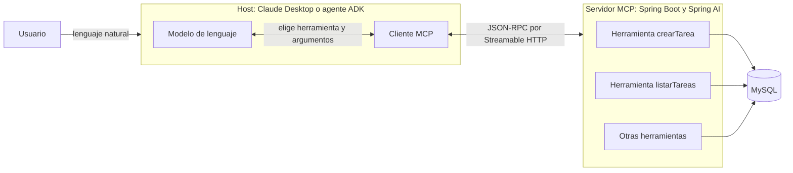

# Actividades para los estudiantes (sección 15 de la guía)

## 10. Herramienta `contarTareas`

Implementada en `TareaToolsService`. Devuelve `repo.count()`.

Su descripción MCP es: "Devuelve el número total de tareas almacenadas, sin importar su estado. Úsala cuando el usuario pregunte cuántas tareas existen; no devuelve el detalle de cada tarea."

El modelo no lee el código Java, solo el nombre, la descripción y el JSON Schema que publica `tools/list`. Por eso la descripción dice qué devuelve, cuándo usarla y en qué se diferencia de `listarTareas`. Así, ante "¿cuántas tareas tengo?", el modelo no necesita traer toda la lista para contarla.

## 11. Herramienta `listarCompletadas`

Implementada con la misma consulta derivada de `listarPendientes`, `findByCompletado`, cambiando solo el argumento a `true`.

Las dos herramientas son complementarias: cada tarea con estado aparece exactamente en una de las dos listas. Con los datos de ejemplo, `listarPendientes` devuelve las tareas 1 y 2, y `listarCompletadas` devuelve la tarea 3. La suma de ambas coincide con `contarTareas`.

## 12. Validación de fecha ISO

`crearTarea` y `actualizarTarea` validan la fecha con `LocalDate.parse(valor, DateTimeFormatter.ISO_LOCAL_DATE)`.

Este formateador comprueba el formato y también que la fecha exista, de modo que rechaza `20/11/2026`, `2026-11-5` y `2026-02-30`. La validación está en el servidor porque las instrucciones del modelo no son un control confiable. El error regresa al cliente como resultado MCP con `isError: true`, y el modelo puede explicarlo al usuario y corregirlo.

## 13. Host, cliente MCP, servidor MCP y herramienta

| Elemento | Responsabilidad | En este laboratorio |
|---|---|---|
| Host | Contiene la conversación y el modelo, y decide qué permite | Claude Desktop, agente ADK |
| Cliente MCP | Negocia el protocolo, lista herramientas y envía `tools/call`. Mantiene una conexión por servidor | Interno del host. En Claude Desktop se apoya en el puente `mcp-remote` |
| Servidor MCP | Anuncia las capacidades y traduce cada llamada a código | Aplicación Spring Boot en el puerto 8088 |
| Herramienta | Una operación concreta con nombre, descripción y esquema | Cada método `@Tool` de `TareaToolsService` |

## 14. Claude Desktop y Google ADK como clientes del mismo servidor

| Aspecto | Claude Desktop | Google ADK |
|---|---|---|
| Tipo de cliente | Aplicación de escritorio ya construida | Agente programado en Java |
| Modelo | Claude | Gemini |
| Conexión | Archivo JSON, con `mcp-remote` como puente STDIO a HTTP | `McpToolset` con `StreamableHttpServerParameters` |
| Código necesario | Ninguno | Clase `TareaAgent` y su POM |
| Instrucciones | Las del usuario en el chat | Definidas en `LlmAgent.instruction` |
| Interfaz | La propia de la aplicación | ADK Web en el puerto 8080 |

Se reutiliza todo el servidor sin ningún cambio: las herramientas, sus descripciones y esquemas, las validaciones, JPA y MySQL. Lo único distinto es la configuración del lado del cliente. Ese es el valor de MCP: una integración escrita una sola vez sirve a cualquier cliente compatible.

## 15. Prueba automatizada

- `src/test/.../service/TareaToolsServiceTests.java` cubre la lógica de negocio: conteo, listas complementarias, validación de título y de fechas, actualización parcial y eliminación.
- `src/test/.../McpProtocolTests.java` levanta el servidor en un puerto aleatorio y usa un cliente MCP real por Streamable HTTP para comprobar el handshake, las 9 herramientas y una llamada válida y otra inválida.

Se ejecutan con `.\mvnw.cmd clean test` sobre H2 en memoria.

## 16. Riesgo de exponer herramientas HTTP sin autenticación

**Riesgo.** Spring Boot escucha por defecto en todas las interfaces de red y el endpoint `/mcp` no pide credenciales. Cualquier equipo que alcance el puerto 8088, por ejemplo en la misma red Wi-Fi de la universidad, puede negociar el protocolo, listar las herramientas e invocar `eliminarTarea` con cada id. No necesita un modelo de lenguaje: le basta un `curl`. El resultado es pérdida o alteración de datos sin rastro de quién lo hizo.

**Mitigación propuesta, por capas:**

1. Limitar la exposición con `server.address=127.0.0.1` cuando el uso sea local. El servidor del supermercado ya lo aplica.
2. Autenticar y autorizar con Spring Security como servidor de recursos OAuth2, exigiendo un token con permisos por herramienta, por ejemplo separando lectura de eliminación.
3. Cifrar el tráfico con TLS en cualquier despliegue fuera del equipo local.
4. Validar el encabezado `Origin` para impedir que una página web maliciosa alcance un servidor local mediante DNS rebinding.
5. Aplicar mínimo privilegio: publicar solo las herramientas necesarias y conectar a MySQL con un usuario propio, sin usar `root`.
6. Registrar cada invocación con su usuario, sin incluir secretos, para poder auditar.
