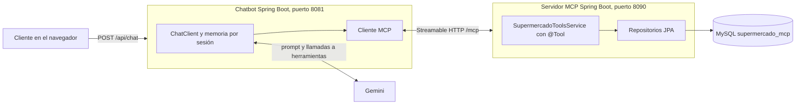
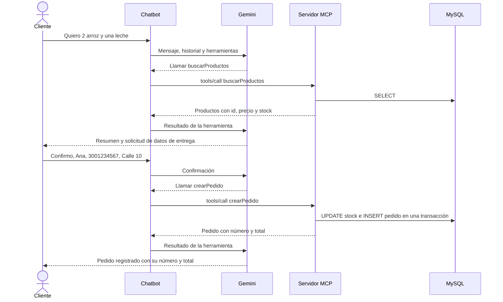

# Ejercicio propuesto: pedidos de supermercado a domicilio por chatbot

Un cliente conversa con un chatbot web para buscar productos y hacer un pedido a domicilio. El chatbot es un cliente MCP que usa las herramientas de un servidor MCP conectado a MySQL.

## Arquitectura



## Explicación paso a paso

### Paso 1. Definir el alcance

El cliente necesita explorar el catálogo, registrar un pedido con sus datos de entrega, consultarlo y cancelarlo. Se reutilizó el patrón de la guía: Spring Boot, Spring AI, `@Tool` y Streamable HTTP. El motor elegido fue MySQL.

### Paso 2. Modelar la base de datos

`mcp-server/src/main/resources/schema.sql` crea tres tablas y carga 28 productos en 9 categorías.

| Tabla | Propósito | Detalle relevante |
|---|---|---|
| `producto` | Catálogo e inventario | `precio` es `DECIMAL`, para no perder exactitud en dinero. `CHECK` impide stock negativo |
| `pedido` | Cabecera con cliente, dirección, estado y total | `version` activa el bloqueo optimista |
| `detalle_pedido` | Una línea por producto | Guarda `precio_unitario` para que el pedido conserve su valor si el catálogo cambia |

El script usa `IF NOT EXISTS` e `INSERT IGNORE`, de modo que se puede ejecutar varias veces sin duplicar datos.

### Paso 3. Crear las entidades y repositorios

`Producto`, `Pedido` y `DetallePedido` mapean las tablas con JPA. `ProductoRepository.descontarStock` ejecuta una sola sentencia `UPDATE ... WHERE stock >= cantidad`, y devuelve 0 si no alcanza el inventario. Como la base de datos serializa esa sentencia, dos compras simultáneas no pueden vender la misma unidad.

### Paso 4. Publicar las herramientas MCP

| Herramienta | Función |
|---|---|
| `listarCategorias` | Devuelve las categorías disponibles |
| `buscarProductos` | Busca por nombre, categoría o ambos, con máximo 20 resultados |
| `crearPedido` | Registra el pedido, descuenta el stock y calcula el total |
| `consultarPedido` | Muestra un pedido, exigiendo su teléfono |
| `listarPedidosCliente` | Muestra los 10 pedidos más recientes de un teléfono |
| `cancelarPedido` | Cancela un pedido en estado `RECIBIDO` y repone el stock |

### Paso 5. Poner las reglas de negocio en el servidor

El modelo solo elige la herramienta y propone los argumentos, así que un error suyo no puede romper las reglas:

- El precio y el total se calculan en el servidor. Los argumentos de `crearPedido` no incluyen precios.
- `crearPedido` es transaccional: si un producto no tiene stock, se revierte el pedido completo.
- Se validan nombre, teléfono, dirección y cantidades de 1 a 50. Las líneas repetidas de un producto se suman.
- Consultar o cancelar exige el teléfono del pedido. Un teléfono equivocado recibe la misma respuesta que un pedido inexistente, para no revelar qué pedidos existen.
- El cambio de estado (preparación, despacho) no se publica como herramienta, porque corresponde al personal de la tienda y no al cliente del chat.

Los métodos devuelven DTO en lugar de entidades JPA, para controlar qué datos recibe el modelo.

### Paso 6. Construir el chatbot

El proyecto `chatbot` integra tres piezas en `ChatbotApplication`:

1. **Modelo:** Gemini, con el starter `spring-ai-starter-model-google-genai`.
2. **Herramientas:** el starter `spring-ai-starter-mcp-client` se conecta al servidor al arrancar, ejecuta `initialize` y `tools/list`, y entrega las herramientas como un `ToolCallbackProvider`.
3. **Memoria:** `MessageChatMemoryAdvisor` conserva la conversación por identificador de sesión, para que el cliente pueda decir "agrega dos más".

`ChatController` expone `POST /api/chat` y `index.html` ofrece la interfaz. La interfaz inserta los mensajes como texto, nunca como HTML, para que una respuesta no pueda inyectar código en la página.

### Paso 7. Dar instrucciones al modelo

`chatbot/src/main/resources/prompts/sistema.txt` define el comportamiento: consultar el catálogo antes de hablar de un producto, nunca inventar precios y mostrar un resumen antes de registrar nada. `crearPedido` solo se invoca cuando el cliente confirma ese resumen.

### Paso 8. Flujo de un pedido



### Paso 9. Seguridad

Los dos servicios escuchan solo en `127.0.0.1`, porque el endpoint MCP no tiene autenticación. La contraseña de MySQL y la clave de Gemini se leen del archivo local `.env`, que git ignora, o de variables de entorno. Para un despliegue real faltaría autenticar con OAuth2, usar TLS y crear un usuario de MySQL sin privilegios de administrador. El teléfono es una verificación básica propia del laboratorio, no una autenticación fuerte.

### Paso 10. Pruebas

```powershell
cd supermercado\mcp-server; .\mvnw.cmd clean test
cd ..\chatbot; .\mvnw.cmd clean test
```

- **Lógica de negocio:** totales, descuento de stock, reversión completa, 12 compras concurrentes sobre 5 unidades, validaciones, propiedad del pedido y cancelación.
- **Protocolo:** un cliente MCP real registra un pedido por Streamable HTTP.
- **Chat:** memoria aislada por sesión, reinicio de conversación, mensajes vacíos y fallos del modelo, con un modelo simulado.

## Cómo ejecutarlo

1. Configure Java 21 en cada ventana de PowerShell: `$env:JAVA_HOME = "C:\Program Files\Java\jdk-21"`. Si aún no existe `.env` en la raíz del repositorio, ejecute allí `Copy-Item .env.example .env` y complete `PWD_UDEA` y `GOOGLE_API_KEY`.

2. Cree la base de datos una vez:

   ```powershell
   & "C:\Program Files\MySQL\MySQL Server 8.0\bin\mysql.exe" -u root -p -e "source C:/ruta/al/proyecto/supermercado/mcp-server/src/main/resources/schema.sql"
   ```

3. Inicie primero el servidor MCP:

   ```powershell
   cd supermercado\mcp-server
   .\mvnw.cmd spring-boot:run
   ```

4. En otra ventana, inicie el chatbot. Debe arrancar después del servidor porque descubre las herramientas al iniciar:

   ```powershell
   cd supermercado\chatbot
   .\mvnw.cmd spring-boot:run
   ```

5. Abra http://localhost:8081. El modelo predeterminado es `gemini-3.5-flash`, porque Google ya no ofrece `gemini-2.5-flash` a cuentas nuevas; para usar otro, defina `GEMINI_MODEL` en `.env`.

## Conversación de prueba

1. "¿Qué categorías tienen?"
2. "Necesito arroz y 2 litros de leche."
3. "Dos de arroz. Soy Ana Pérez, 3001234567, Calle 10 # 20-30." El bot debe mostrar un resumen y pedir confirmación, sin registrar el pedido todavía.
4. "Sí, confirmo." El bot debe informar el número de pedido.
5. "¿Cómo va mi pedido?" con el número y el teléfono.
6. "Cancélalo." El bot debe confirmar antes de cancelar.

Verificación en MySQL:

```sql
USE supermercado_mcp;
SELECT id, cliente_nombre, estado, total FROM pedido;
SELECT nombre, stock FROM producto WHERE nombre IN ('Arroz blanco', 'Leche entera');
```
